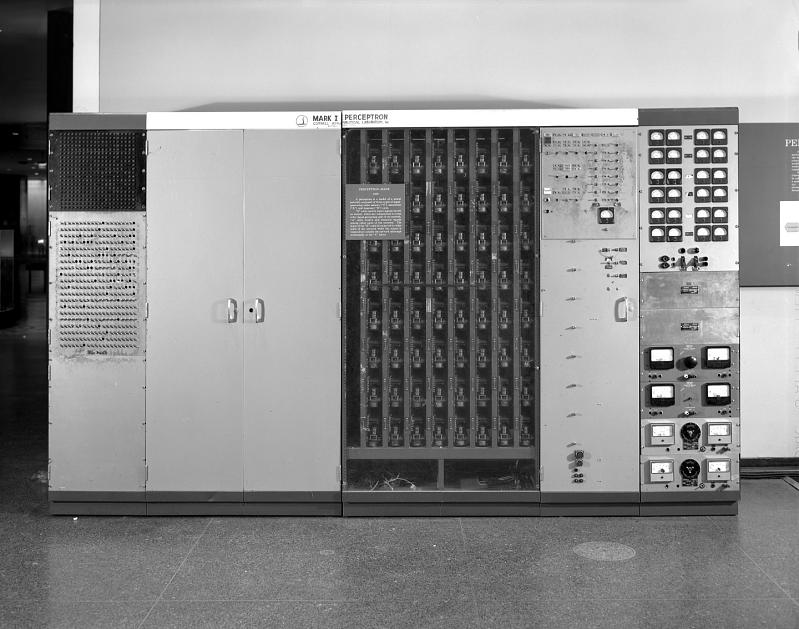

# Part 02 — Neural Networks: How One Network Learns
## 畫面分鏡、聲音與動畫設計草案

**狀態：** 本分鏡對應 2,424 字英文稿；Charon 旁白已生成，最終 WAV 長 17:25.8（約 139 wpm 平均，含短段落接縫）。Chapter 1–4 的音訊時鐘動畫已實作並放入 chapter preview；Chapter 4 已完成代表 cue 的 browser QA，仍待整章 overflow/fullscreen review。Chapter 5、BGM 與 MP4 尚未製作。章節內精確 cue 以實際旁白 playback QA 為準。

## 製作目標

用一條連續、易懂的視覺旅程，讓沒有技術背景的觀眾看見神經網絡怎樣計算，再看見它怎樣由資料或任務表現學習。畫面要直接反映旁白正在講的事，不能只出現標題、公式或科技背景。

歷史內容以短暫、有來源的照片插鏡增加真實感；照片只負責回答「這是何時、當時的設備大概長甚麼樣」，真正原理仍由當下的動畫說清楚。Peppered moth 的生物演化段落會使用動態科學插畫，而不是把低清或版權未確認的圖片放大成背景。

| 章節 | 旁白音檔約時間 | 核心畫面問題 |
|---|---:|---|
| 01 — AI 的核心概念 | 00:00–00:59.6 | 人工神經元和早期 perceptron 是甚麼？ |
| 02 — 一個神經元的計算 | 00:59.6–03:53.9 | RGB 數值怎樣經過 weights、bias、activation 變成 light/dark 機率？ |
| 03 — 由一個單元到 layers | 03:53.9–06:14.5 | 多個計算怎樣組合成較複雜的分類？ |
| 04 — 標註範例與 backprop | 06:14.5–11:13.7 | 網絡如何比較預測與答案，再調整參數？ |
| 05 — 自然選擇到 Snake neuroevolution | 11:13.7–17:25.8 | 沒有每一步標準答案時，如何以表現分數選擇並改變網絡？ |

## 歷史圖片候選與使用限制

這張 Smithsonian Mark I Perceptron 影像已用於 Chapter 1 預覽。Smithsonian 物件頁標示「CC0 Usage Conditions Apply」；官方說明 CC0 圖片可重用，但仍須保留 National Museum of American History, Smithsonian Institution 的署名，且不可暗示博物館贊助或認可。完整來源、credit 和條款註記見 `series/neural-networks/references/README.md`。[1]

Cornell 的文章有 Frank Rosenblatt 與 perceptron 設備的歷史照片，並標明 Cornell Division of Rare and Manuscript Collections。可作為來源參考，但未取得重用許可前不下載進 production assets 或用於公開影片；可用 Smithsonian 設備照或自製示意替代。[2]

Peppered moth 段落優先用自製或已授權的兩種蛾型插畫，搭配樹皮、鳥類視線與族群比例變化；不可用一張定格圖片代替演化機制，也不可讓單隻蛾由淺色直接變成深色。Oxford University Museum 的教材可作生態背景與圖像參照，但其中實驗照片若要採用，也需另外確認授權。[3]

## 整體視覺語言與連貫物件

- 延續 Part 01 深海軍藍、克制的 cyan／mint、高對比白字與少量琥珀色提示。畫面保持 16:9、1920×1080、24 fps；不用標題卡、不放完整旁白字幕。
- 開場仍是熟悉的 AI chat UI，文字在畫面下方輸入；對話送出後才移到上方。畫面不是網頁 demo，而是最後影片會出現的全幅 16:9 畫面。
- 核心物件必須延續：AI 回答泡泡中的 neuron 圖示 → RGB 計算中的單一 neuron → 擴展成 toy network → 同一組 weights 進入訓練 → network 複製成多個候選者 → Snake 評分與下一代。
- 生物自然選擇段落不把 moth 直接「變成」神經網絡。用清楚標示的 `BIOLOGY` 與 `NETWORK SEARCH` 兩段視覺世界，以相似的「族群變異／不同結果」構圖作概念對照，但保留它們不是同一回事的視覺分隔。
- 任何數字、機率和訓練分數若屬示意，須以 `ILLUSTRATIVE EXAMPLE` 小標明，避免被理解為真實模型的量測值。重點標籤需足夠大；同一時間最多一個主要概念和少量輔助資訊。
- 歷史照片或示意文件以羊皮紙／草紙質感的紙片 overlay 進場：有輕柔彎曲、翻起與落定的彈性，但不能像厚硬簡報卡。照片仍須保留真實內容與清晰 credit；不偽造原始檔案、不全螢幕放大，也不以濾鏡掩蓋來源。完整 credit 與授權說明另記於影片描述及素材清單。

## 分鏡 01 — AI 的核心概念｜音檔約 00:00–00:59.6

**旁白 cue：** “What is the most important thing inside AI?”、“one of the central engines … the neural network”、“In 1943 … McCulloch and Pitts”、“In 1958 … Frank Rosenblatt … perceptron”。

1. **先建立熟悉介面。** 暗色 AI 對話畫面尚未有標題。鏡頭停在底部 composer，游標開始輸入觀眾問題。旁白問句說完後按 Send，使用者訊息才移到上方成為對話泡泡；介面有很輕的 glow／粒子動態，但留白不空洞。
2. **答案帶出 neural network。** Assistant 回覆只顯示短句：「Neural networks are one core engine of modern generative AI.」字句出現時，左側的小 network icon 由幾個節點連起來；講到「numbers go in, calculations transform them, and numbers come out」時，三個簡單數字粒子穿過同一結構後輸出，不要只顯示一張網絡插圖。
3. **1943：由生物啟發的數學模型。** 神經元示意圖（樹突接收、細胞體、軸突輸出）先短暫出現，接著平面化成乾淨的數學節點。畫面顯示大字 `1943` 與 `McCulloch + Pitts`，一張帶紙紋、柔性彎入的現代示意紙片同步落定，並標清它不是原始文獻；不偽造論文掃描或標題。
4. **1958：perceptron 的歷史設備。** 聽到 Rosenblatt/perceptron 時，一張 Smithsonian Mark I 實物照片以帶細微紙紋的紙片 overlay 推入畫面（約佔畫面三分之一，不遮住主流程）；彎曲後自然落定，credit 清晰可讀。旁邊標記 `MARK I PERCEPTRON · 1958`。以照片上的面板細節作短視差，再把一顆面板旋鈕轉成現代單一計算 node。可選 Cornell archival 照片只在取得許可後使用。[1] [2]
5. **銜接 RGB 範例。** 年代線收束到一顆簡潔的 neuron node；節點保持在畫面中心，下一章的 RGB 色塊由左側滑入。整段不突然淡出／重建 neuron。

**聲音：** 前 1.5 秒以柔和的低頻 cyber-space pad 建立 chat UI，再開始旁白。發送訊息用一次輕 click；歷史照片出現只加低音量紙張／機械質感，不做電影預告式 impact。

## 分鏡 02 — 一個 artificial neuron 的計算｜音檔約 00:59.6–03:53.9

**旁白 cue：** “one grey color swatch”、“red, green, and blue”、“Each input is multiplied by a weight”、“add the weighted values”、“Next comes the bias”、“activation function … sigmoid”、“seventy-one percent probability of light”。

1. **固定唯一小任務。** 一塊大灰色色塊放在 neuron 左側，標籤 `LIGHT OR DARK?`。講到 RGB 時，色塊拆成三條大色道 R、G、B，各自顯示 `0.8`；同時在角落小字標明數字為示意。此處不再留歷史照片。
2. **Weight 是輸入影響力旋鈕。** 三條色道各自流入一個可動旋鈕，旋鈕停在 `×1.0`。旁白說「weight controls how strongly an input contributes」時，每條訊號的粗細隨旋鈕值作比例變化；因本例三個 weights 都是一，三條線保持同等寬度。
3. **相加與 bias。** 三個 `0.8` 依次落到大型加法節點，合成 `2.4`。單獨的 bias chip `−1.5` 由下方滑入，像偏移刻度般改變門檻，算出 `score 0.9`。不要把 bias 畫成第四個 RGB channel。
4. **Activation 轉成可讀的輸出。** 一道簡單的 S-shaped sigmoid curve 放大到中央，dot 沿曲線落在 `0.9 → 0.71`。旁邊兩個大概率 bar 顯示 `P(LIGHT) 71%` 與 `P(DARK) 29%`。不用播出 sigmoid 方程；公式只可作最後一刻短暫提示，不取代動畫。
5. **同一 network 測試深色 swatch。** 原 neuron 不換皮。左側灰色 swatch 平順變深；RGB 三值改為 `0.2`，結果依次呈現 `0.6 → −0.9 → 0.29`；概率 bar 翻轉為 `LIGHT 29% / DARK 71%`。每次只亮正在旁白講的數字，避免滿屏運算式。
6. **收束概念並帶入 layers。** 輸入、旋鈕、bias、sigmoid、輸出以一條清楚路徑停留 1–2 秒。講到「one neuron cannot understand an image」時，後方浮現更大的 pixel patch 輪廓；同一顆 neuron 仍留在前景。

**聲音：** 每次乘法與加法用很輕的短提示音，概率 bar 完成時一個柔和 resolve tone。不可每個數字都加提示音，以免節奏變成遊戲教學，也不可用重低音壓住 0.8、2.4、−1.5、0.9 等重要數值。

## 分鏡 03 — 由一個單元到多層網絡｜音檔約 03:53.9–06:14.5

**旁白 cue：** “tiny image patch”、“A layer is a group of artificial neurons”、“hidden layer—not because it contains a secret thought”、“stripe or plain”、“activation function changes that”、“one straight line”。

1. **同一色塊擴成小 patch。** 原本色塊切成 3×3 小像素；每格有 RGB 數值色點。不要讓色塊消失後換成另一張無關圖片；用切分動畫連續擴張。
2. **原有 neuron 複製成 layer。** 單一 node 保留為第一個計算單元；向右增長數個 node，再由中間一層連至輸出。用三個大型區域 label `INPUT`、`HIDDEN`、`OUTPUT`。Hidden 只用視覺位置說明在中間，不用黑箱、眼睛或腦袋暗示「秘密想法」。
3. **展示中間值如何被下一層接收。** 第一層輸出的小光點成為下一層輸入，逐層傳遞；光點沿既有 SVG 連線移動，讓訊號方向和跨層交接一眼可辨。只用少量連線，避免線網塞滿整個畫面。節點以不同輸入權重產生不同反應，但不把真實網絡神經元稱作固定的「條紋偵測器」。
4. **Toy task：stripe / plain。** 一塊有條紋的 pixel patch 進入小網絡；幾個中間訊號合併，輸出 `STRIPE`。換成單色 patch 後，同一 network 輸出 `PLAIN`。所有示意單元角落標 `TOY EXAMPLE`，只解釋範例，不宣稱微型網絡能理解完整照片。
5. **Activation 為何重要。** toy patch 與 network 退到背景，中央轉為一張獨立的兩群點示意圖。先以直線分開簡單群組；旁白說到「pattern bends」時，同一批點移成中心群與外圈群；再隨「network can combine multiple stages」淡出直線、畫出彎曲分界。小型 S-curve 訊號圖示隨 activation 旁白流動。此圖只說明非線性運算讓組合更靈活，不把兩群點硬說成前面的 stripe/plain pixel patch，也不引入 XOR 名詞。
6. **保留 network 進入訓練。** 邊界圖退場，原有 network 留在畫面。旁白說「More layers」時才顯示可調 weights 旋鈕；到「still need to be trained」才出現對應提示。下一章不是重建全新網絡，而是沿用這一組節點與權重開始學習。

**聲音：** 層間傳遞用低音量資料 pulse；Activation 帶來邊界彎曲時以柔和上行音表示表示能力增加，不用強烈升調或誇張 whoosh。

## 分鏡 04 — 用標註範例與 backprop 訓練｜音檔約 06:14.5–11:13.7

**旁白 cue：** “examples … swatch … label”、“The network does not know that rule in advance”、“perhaps … twenty percent probability”、“The supplied answer”、“loss is large”、“Backpropagation calculates”、“gradients”、“optimizer”、“same color again”、“examples that were held aside”。

1. **由手調參數切換到訓練資料。** 保留同一個 RGB network。旋鈕短暫停下，旁邊展開小型 dataset tray。每張 sample card 只放一個色塊與一個 label，例如 `PALE GREY → LIGHT`、`DARK BLUE → DARK`。資料先在 network 外，標籤未進入模型。
2. **人先提供一致標籤。** 旁白說人同意 label 規則時，兩張範例卡在旁邊排好；network 只接收色塊 RGB，正確答案只由獨立 target lane 流向比較器。用箭頭明確區分 `INPUT` 與 `SUPPLIED ANSWER`。
3. **第一次預測出錯。** 權重初始值顯示為未調好，但不要顯示一大團任意數字。輸入淺灰色後，模型輸出 `LIGHT 20% / DARK 80%`。等旁白讀到「the answer attached … light」才翻開 target label `LIGHT`，並讓 target 進入 comparator，不是回到輸入層。
4. **Loss 是這一個任務的誤差度量。** 預測的 20% 與 target `LIGHT` 並排，loss meter 由低轉高。只寫 `TASK LOSS`，避免紅色警報或「INTELLIGENCE SCORE」等錯誤暗示。
5. **Backpropagation 顯示參數如何影響 loss。** 從 loss meter 沿著 network 向左回溯，逐個亮起影響較大的參數旋鈕；每個參數旁顯示方向箭頭／微小梯度刻度。反向光線是 gradient 計算的視覺比喻，不是一粒實體錯誤球，也不是生物腦訊號。
6. **Optimizer 小幅更新，不瞬間變完美。** 被指出的幾個 weights 和 bias 微調少量，然後重新 forward 同一塊灰色；`P(LIGHT)` 由 20% 微升（例如 31%，明確是示意）並使 loss 降低。不可一次更新就變成 100%。
7. **重複、批次與泛化檢查。** Dataset 多張色卡依次送入同一 network；用一條短 loop `PREDICT → COMPARE → UPDATE` 多次重複，配合權重逐步變化。最後把訓練用卡移到 `PRACTICE SET`，另以未見過的新色塊進入 `HELD-OUT CHECK`。結果顯示「檢查是否學到可轉移的模式」，不宣稱能保證每個真實場景都正確。
8. **語言模型提示一瞥。** 旁白提到未來「next word in the text」時，只短暫顯示一條文字前綴，下一個原文 token 從文件中飛到 target lane。此段控制在數秒，只讓觀眾知道「答案也可以由資料本身提供」，不開始介紹 tokenization、LLM 或 Transformer，以免提前跳出本集。
9. **交接到新訓練方法。** `PREDICT / COMPARE / UPDATE` loop 縮回網絡旁，sample cards 收入一側；旁白開啟「But labelled answers are not always available」後，訓練資料面板轉成多個候選網絡，不要先出現 moth 或 mutation 標籤，讓下一段依照旁白逐步帶出。

**聲音：** Training loop 以輕而穩定的低頻 pulse 表示重複，不加入急促節拍。Loss 增加時可以有短促但柔和的低音；權重微調用細微 click，讓耳朵也感受到「小幅更新」。

## 分鏡 05 — 自然選擇啟發的 Snake neuroevolution｜音檔約 11:13.7–17:25.8

**旁白 cue：** “labelled answers are not always available”、“trying many candidate networks”、“selection … mutation”、“biological evolution”、“peppered moth”、“industrial soot”、“mutations create variations”、“non-bird dinosaurs”、“An algorithm can use a simplified version”、“Snake game”、“fitness score”、“randomly change a few weights”、“generation”、“success in Snake does not mean general intelligence”。

### 05A — 先把候選網絡方法講清楚，再講生物啟發

1. **無逐局正確答案的問題。** 延續前章 RGB 範例，target label lane 收起；新的簡單 Snake board 出現，旁白指出可以量度整局表現，但很難替每個盤面預先寫出正確方向。用大字提示 `NO LABEL FOR EVERY MOVE`。
2. **演算法的核心動作先現身。** 一排四至六個外觀相同但權重旋鈕略有差異的 mini network 出現。每個網絡各跑一次簡短遊戲片段，表現以分數條作比較；較高分者較多進入 `KEEP` 區，然後複製並對少數權重作隨機微調。用旁白詞同步命名 `SELECTION`（較佳候選者保留／複製）與 `MUTATION`（隨機改變，可能好亦可能壞）。先有直覺流程，再問生物啟發從何而來。
3. **清楚分開兩種世界。** 候選 network 暫停並縮入畫面右側小窗，左側打開自然環境插畫，標示 `BIOLOGY`。不要讓電腦節點變成 moth 或宣稱真實演化等於演算法；兩邊只以視覺構圖相似來比較。

### 05B — Peppered moth：環境變、族群比例隨世代改變

4. **淺色樹皮時。** 近拍淺色、有 lichen 的樹皮，畫面上有淺色和深色兩種蛾。鳥的視線掃過，淺色蛾較難被看見；一個概念性 population row 顯示淺色變異在下一代保留較多。此處使用自然史插畫或已授權圖片；若用圖片，需讓樹皮與蛾的偽裝差異清楚，不用背景特效遮細節。
5. **工業污染令環境改變。** 黑色 soot 粒子由工廠煙囪落到樹幹，樹皮隨之變深。蛾個體不變色；鏡頭先停住兩種既有變異，再切換世代 row，較深色的個體在新一代比例提高。配合旁白說「more common over generations」才改變族群比例。
6. **污染下降，優勢再轉變。** Soot 停止，樹皮逐漸恢復淺色；下一代的族群條再次改變。變的是背景環境和跨世代比例，不是單隻 moth 有意識地調色。明顯展示「mutation 隨機出現；環境影響哪些變異較容易繁殖」，不要畫成環境命令 moth 變色。
7. **滅絕補充。** 用一條簡潔的分支圖說明約 66 million years ago 的事件：`NON-BIRD DINOSAURS` 支線消失，`BIRDS` 支線延續。只用小型 asteroid symbol 和分支停止／延續，不做災難電影畫面。標籤要清楚分辨「非鳥類恐龍」和「鳥類是仍存續的恐龍支系」，不能顯示「所有恐龍全滅」。這是旁白中的短補充，不在這裡延伸另一段歷史課。[4]

### 05C — 把自然界的抽象模式用在 Snake 網絡

8. **由 BIOLOGY 回到 ALGORITHM。** moth population row 收起為明確的分隔線，network candidates 仍留在右側小窗，擴大回到主畫面。標示 `ANALOGY, NOT THE SAME PROCESS` 一瞬間後收起，避免長時間塞字。旁白稱之為 `NEUROEVOLUTION` 時才出現該詞。
9. **展示 Snake 網絡輸入和輸出。** 一個大而乾淨的 Snake game board 在左，三個輸入圖示清楚表達食物方向、危險位置和蛇目前前進方向。右側同一網絡輸出三條動作分數：`STRAIGHT`、`LEFT`、`RIGHT`；亮起最高分後，蛇跟著走一步。不要再加文字解說。
10. **一群 network 一起測試。** 同一 board 變成四個平行的小測試場景，每個候選網絡使用不同的參數束，操作結果不同：有的撞牆，有的撞到自己，有的吃到蘋果。其分數牌逐一變化，行動和分數同步對應。
11. **Fitness 由設計者定義。** 聽到 apple/crash cue 時，蘋果進食加分、撞擊扣分；出現大型 `FITNESS` 分數牌。分數來自整局結果，沒有教練在每一格 board 上標出正確動作。這可視化地與上一章的 input-label cards 對比。
12. **Selection、copy、mutation、new generation。** 高分候選者進入前排並複製其 weight bars；少量旋鈕隨機跳動，並以小幅度顯示可有正負方向的變化。新一代再次跑不同起始盤面，重複 `TRY → SCORE → SELECT → MUTATE → TRY AGAIN`。五個大型詞依旁白 cue 逐一亮起，不預先同時塞滿畫面。
13. **避免只選到運氣。** 同一候選者在兩三個不同起始盤面上跑，分數合併後再排名；不需要顯示真實統計公式。強調多次遊戲較能降低單場運氣影響，不代表完全排除隨機。
14. **與 supervised learning 並排比較。** 左邊回放一個色卡：`SUPPLIED ANSWER → GRADIENT UPDATE`；右邊 Snake：`GAME SCORE → SELECT + MUTATE`。使用兩條清楚流程而非字很多的比較表。旁白講兩者差異時，左側 label 只進 comparator，右側 fitness 只從遊戲結果回來。
15. **說明方法限制。** Fitness badge 由人設計；短暫顯示分數設計不佳會鼓勵意外行為，然後消失。Snake 表現好只代表在該遊戲／指標下得分高，不能跳到 `GENERAL INTELLIGENCE`。

### 05D — 結尾懸念與 CTA

16. **收束本集已學內容。** RGB 色塊 → 單一 neuron → layers → supervised update → Snake population 的物件縮成一條短時間路徑，按順序亮起；不加總結 slide。
17. **提出 LLM 懸念但不說集數。** 對「LLMs seem to go much further」的旁白，畫面不要將 Snake 網絡直接變成 LLM。讓 RGB 和 Snake 兩個專用網絡停在畫面一側；另一側獨立出現三張短 text request 卡，例如 `EXPLAIN`、`COMPARE`、`PLAN`，同時指向一個尚未展開的中性 network silhouette。配合問題逐步放大問號與文字 token，留待下一部影片解釋內部機制。
18. **CTA 自然落地。** 旁白說 “please like the video and subscribe” 時，右下方輕量出現 Like／Subscribe 的 app-like 控件，做一次簡單 click／確認狀態；不把 UI 放大成 outro 標題卡，也不讓社群圖示蓋過畫面。結尾留約 1.5–2 秒乾淨 hold，再將音樂柔和收束。

**聲音：** 自然演化段落可加極低音量的風聲／樹林空氣感；工業 soot 出現時加入克制的環境低鳴，不用誇張煙囪爆音。Snake loop 可在 apple/collision 使用柔和短音，但不要做成 arcade 遊戲音樂。候選者獲選時用短 click，mutation 的音效不應暗示每次變異都是成功。最後 CTA 只有一次柔和確認音。

## 旁白與音樂製作方案

- **旁白：** 沿用 Part 01 的 Charon、en-US 聲線；此次 TTS 使用 `warm, clear, speaking slowly`，再作 5% pitch-preserving slowdown，讓整體更從容。成品 WAV 長 17:25.8，約 139 wpm（以總時長計，含短段落接縫）；仍需使用者聽一次確認節奏與人名讀音。
- **節奏：** 目前完成的旁白約 139 wpm 平均，較原先 115–120 wpm 規劃快；如 review 後仍覺得急，可再調整語速。音畫 cue 仍要在旁白講到 `2.4`、`−1.5`、`0.9` 和 `71%` 時精確落點；selection/mutation 解釋後及 moth 世代變化後保留辨認畫面的呼吸空間。
- **音樂：** 稀疏 cyber／space exploration ambience，無人聲、無明顯鼓點、無搶耳主旋律。開場先播約 1.5 秒，建立 chat UI 後入旁白；RGB 計算用溫和電子脈衝，backprop 用低調循環節奏，moth 歷史短暫加入有機／空氣質感，Snake 部分用稍有推進感但不強烈的低頻節奏，結尾留下輕微未解和弦後淡出。
- **混音：** 旁白永遠清楚在前，BGM 起始 gain 先以 Part 01 的 0.10 preview gain 作參考，再以耳聽與峰值檢查微調；有音效時為旁白讓位，避免強拍覆蓋 RGB 數字、loss、selection 和 fitness 關鍵詞。旁白與 BGM 保留分軌，製作時可獨立調整。
- **音檔結構：** 旁白已分三段生成並合併；接縫各留 0.8 秒自然呼吸空間。最終 WAV 已留 −3 dB peak headroom，MP3 為聆聽 preview。自動轉寫產生的近似 timing JSON 可供動畫初始定位，但不是 word-level alignment；正式校準仍須人工確認 `McCulloch`、`Rosenblatt`、`perceptron`、`sigmoid`、`neuroevolution` 的讀音、停頓和 cue。

## 技術、節奏與 QA 規格

- 動畫預覽的唯一主時鐘是 voiceover `audio.currentTime`；每個 cue 以絕對秒數／章節 progress 計算，提供可重現的 `renderFrame(frame)`。seed 隨機粒子、Snake 候選者與 moth 預覽狀態，確保拖曳、pause、不同路徑 seek 到相同時間都顯示相同畫面。
- 音樂與音效跟隨播放、暫停、seek 及播放速度；旁白作主時鐘。場景邊界不出白色 overlay；鏡頭和物件以持續移動／變形手交，不淡出整個畫面後重建。
- 本分鏡時間只按文字與 120 wpm 估算。Voiceover 完成後應逐句建立 cue-to-audio timing，特別校準每一個 RGB 數字、70/30 機率、dataset label、loss、moth 背景切換、selection/mutation、fitness 與 ending CTA；不可把估算秒數當作最後同步資料。
- 先做代表性 10–15 秒片段 QA，建議選「灰色 swatch → 0.8/2.4/bias/sigmoid/71%」或「moth 世代變化 → network selection」。用 pause／seek 從前後不同位置重播，確認物件不跳變、字不重生、動畫確實對準旁白。
- 先在網頁 preview 完成全片章節 QA，不先 render MP4。檢查 16:9 full-frame、字體可讀性、歷史照片清晰度及授權、聲音混音與最後 CTA；使用者完成 preview review 後再討論 MP4 export。

## 主要參考來源

[1] [Smithsonian National Museum of American History — Electronic Neural Network, Mark I Perceptron](https://americanhistory.si.edu/collections/object/nmah_334414)（物件記錄：1958；頁面列示 CC0 usage conditions，同時提醒查閱重用條款）。

[2] [Cornell Chronicle — Professor’s perceptron paved the way for AI, 60 years too soon](https://news.cornell.edu/stories/2019/09/professors-perceptron-paved-way-ai-60-years-too-soon)（包含 Rosenblatt 與 perceptron 的歷史照片及來源 credit；公開使用前須確認影像權利）。

[3] [Oxford University Museum of Natural History — Peppered Moth natural selection experiments](https://learningzone.oumnh.ox.ac.uk/peppered-moth-natural-selection-experiments)（蛾型、污染環境與自然選擇實驗背景）。

[4] [Natural History Museum — What is natural selection?](https://www.nhm.ac.uk/discover/what-is-natural-selection.html)（遺傳差異、環境、繁殖成功率與選擇並非保證生存的說明）。

[5] [Natural History Museum — How an asteroid caused extinction of dinosaurs](https://www.nhm.ac.uk/discover/how-an-asteroid-caused-extinction-of-dinosaurs.html)（非鳥類恐龍滅絕與鳥類存續的表述）。
